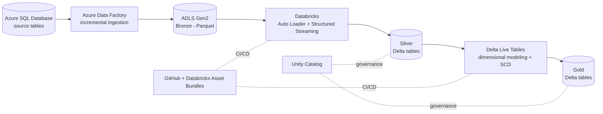

# Spotify End-to-End Data Engineering Project (Azure)

An end-to-end data engineering pipeline on Azure. Spotify-style streaming data is
ingested incrementally from **Azure SQL Database** into a **Data Lake** with
**Azure Data Factory**, then transformed through a **medallion architecture**
(Bronze → Silver → Gold) in **Azure Databricks** using PySpark, Spark Structured
Streaming, Auto Loader, Unity Catalog, and Delta Live Tables. The Databricks code
is packaged and deployed with **Databricks Asset Bundles**.

## Architecture



## Tech Stack

| Layer | Tools |
|---|---|
| Source | Azure SQL Database |
| Ingestion / orchestration | Azure Data Factory (Lookup, ForEach, Copy, Script, Set Variable, If Condition) |
| Storage | Azure Data Lake Storage Gen2 (bronze, silver, gold containers), Parquet, Delta |
| Transformation | Azure Databricks, PySpark, Spark Structured Streaming, Auto Loader |
| Modeling | Dimensional modeling, Slowly Changing Dimensions (SCD), Delta Live Tables |
| Governance | Unity Catalog |
| Deployment | Databricks Asset Bundles (dev and prod targets) |
| Version control | Git and GitHub |

## Data Model

The source database holds one fact table and four dimension tables:

| Table | Type | Incremental column |
|---|---|---|
| `DimUser` | Dimension | `updated_at` |
| `DimArtist` | Dimension | `updated_at` |
| `DimTrack` | Dimension | `updated_at` |
| `DimDate` | Dimension | `date` |
| `FactStream` | Fact | `stream_timestamp` |

## Pipeline Design

### 1. Incremental ingestion (Azure Data Factory)

A parent pipeline (`incremental_loop`) runs a **ForEach** over the table list in
[`loop_input.json`](loop_input.json), so one parameterized design handles every
table. Each entry defines the `schema`, `table`, incremental column (`cdc_col`),
and an optional `from_date`.

For each table, the ingestion logic uses a **watermark** pattern:

1. **Lookup (`last_cdc`)** reads the last loaded value from
   `<table>_cdc/cdc.json` in the bronze container.
2. **Set variable (`current`)** captures the run's timestamp, so the whole run uses
   one consistent upper boundary.
3. **Copy data (`AzureSqlToLake`)** pulls only rows where the incremental column is
   newer than the watermark and writes them to Bronze as **Parquet**, using
   dynamic datasets.
4. **If Condition (`ifIncrementalData`)** checks whether any rows were loaded.
   - **True:** a **Script** activity (`max_cdc`) finds the newest loaded value and
     a **Copy** activity (`update_last_cdc`) writes it back to `cdc.json`.
   - **False:** an empty output file is cleaned up (`DeleteEmptyFile`).

A failed run leaves the watermark unchanged, so the next run retries the same
window and no data is skipped. The first run starts from `1900-01-01`
(see [`cdc.json`](cdc.json)) and loads everything.

### 2. Silver layer (Databricks)

The `silver_Dimensions` notebook reads each Bronze folder with **Auto Loader**
(`cloudFiles`, Parquet, schema evolution set to add new columns) and writes Delta
tables with **Structured Streaming** (`trigger(once=True)`) into Unity Catalog
tables under `spotify_cata.silver`.

Transformations include:

- Dropping the `_rescued_data` column through a reusable helper in `utils/`
- De-duplicating dimensions on their business keys (`user_id`, `artist_id`)
- Standardizing text, for example upper-casing `user_name` and cleaning `track_name`
- Deriving a `durationFlag` (low / medium / high) from track duration

### 3. Gold layer (Delta Live Tables)

Delta Live Tables build the Gold dimension and fact tables in `spotify_cata.gold`,
with **Slowly Changing Dimension** handling for the dimensions. A **Jinja2**-driven
notebook generates the SQL for the analytics joins (the fact stream joined to users
and tracks) from a list of parameters, instead of hand-writing each query.

### 4. Governance and deployment

- **Unity Catalog** organizes data as `catalog.schema.table`
  (`spotify_cata.bronze`, `.silver`, `.gold`) with access control and lineage.
- The Databricks code is packaged as a **Databricks Asset Bundle** with separate
  `dev` and `prod` targets and version-controlled in GitHub.

## Repository Structure

```
.
├── factory/                  # Data Factory pipelines, datasets, linked services
├── source_scripts/
│   ├── spotify_initial_load.sql      # creates and loads the source tables
│   └── spotify_incremental_load.sql  # new rows to test the incremental load
├── Databricks Code/
│   └── spotify_dab.dbc       # Databricks Asset Bundle export (silver, gold, Jinja)
├── loop_input.json           # table list the ForEach loop iterates over
├── cdc.json                  # starting watermark: {"cdc": "1900-01-01"}
├── empty.json                # empty JSON placeholder file
└── README.md
```

## How to Run

1. **Azure setup:** create a resource group, an ADLS Gen2 storage account
   (hierarchical namespace on) with `bronze`, `silver`, and `gold` containers, an
   Azure SQL server and database, a Data Factory, and a Premium-tier Databricks
   workspace with Unity Catalog.
2. **Source data:** run `source_scripts/spotify_initial_load.sql` in the SQL
   database's Query editor.
3. **Watermark files:** for each of the five tables, upload `cdc.json` and
   `empty.json` to `bronze/<table>_cdc/`.
4. **Ingestion:** run the `incremental_loop` pipeline in Data Factory.
5. **Test incremental loading:** run `spotify_incremental_load.sql`, then run the
   pipeline again. Only the new rows should land in Bronze.
6. **Databricks:** import `spotify_dab.dbc`, update the storage account name in the
   `abfss://` paths, then run the silver notebook and the Delta Live Tables
   pipeline.

## Challenges and Fixes

- **Azure policy blocked resource group creation:** the tenant required `Owner`,
  `Cost Center`, and `IaC managed` tags, which I added on the Tags tab.
- **SQL Database region restrictions:** no SQL quota in some regions, so the
  server was created in a region that allowed it.
- **SQL login failures from Data Factory:** reset the admin password and updated
  the linked service.
- **Lookup output shape:** with *First row only* on, the output is `firstRow`, not
  `value`, which broke `output.value[0]` expressions.
- **Expression details:** the Script activity output is `resultSets` (case
  sensitive), and `item()` only works inside a ForEach, so the child pipeline uses
  `pipeline().parameters` instead.
- **Missing dot in the loop's SQL query:** schema and table were concatenated
  (`dboDimUser`) until I added the `.` between them.
- **Missing watermark file:** the Lookup failed with `PathNotFound` until every
  table had a starter `cdc.json`.
- **Connection timeouts under parallel load:** handled with retries and
  sequential runs.


## Author

**Minal**: MS in Information Systems, Northeastern University
