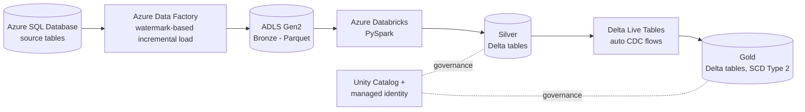

# Spotify End-to-End Data Engineering Project (Azure)

An end-to-end data pipeline on Azure. Spotify-style streaming data is loaded
incrementally from **Azure SQL Database** into **ADLS Gen2** with **Azure Data
Factory**, cleaned into **Delta** tables with **PySpark** in **Azure Databricks**,
and modeled into a gold layer with **Delta Live Tables**, including **SCD Type 2**
history. Tables are governed with **Unity Catalog**, and the Databricks workspace
reaches the lake through a **managed identity** (no storage keys).

I tested it end to end by changing rows in the source database and tracing the
changes through every layer (see [Results](#results)).

## Architecture



## Tech Stack

| Layer | Tools |
|---|---|
| Source | Azure SQL Database |
| Ingestion / orchestration | Azure Data Factory (Lookup, ForEach, Copy, Script, Set Variable, If Condition) |
| Storage | Azure Data Lake Storage Gen2 (bronze and silver containers), Parquet, Delta Lake |
| Transformation | Azure Databricks, PySpark, Auto Loader (initial silver load) |
| Modeling | Delta Live Tables (Lakeflow Declarative Pipelines), SCD Type 1 and Type 2 |
| Governance and security | Unity Catalog, Access Connector with managed identity, external locations |
| Version control | Git and GitHub (Data Factory is connected to this repository) |

## Data Model

| Table | Type | Incremental column |
|---|---|---|
| `DimUser` | Dimension | `updated_at` |
| `DimArtist` | Dimension | `updated_at` |
| `DimTrack` | Dimension | `updated_at` |
| `DimDate` | Dimension | `date` |
| `FactStream` | Fact | `stream_timestamp` |

The initial load is 2,865 rows (500 users, 500 artists, 500 tracks, 365 dates,
1,000 streams).

## Pipeline Design

### 1. Bronze: incremental ingestion (Azure Data Factory)

A parent pipeline (`incremental_loop`) runs a **ForEach** over the table list in
[`config/loop_input.json`](config/loop_input.json), so one parameterized design
handles all five tables. A child pipeline (`incremental_ingestion`) does the work
for one table using a **watermark**:

1. **Lookup (`last_cdc`)** reads the last loaded value from
   `<table>_cdc/cdc.json` in the bronze container.
2. **Copy (`AzureSqlToLake`)** pulls only rows where the incremental column is
   newer than the watermark and writes them to bronze as **Parquet**, using
   dynamic datasets.
3. **If Condition (`ifIncrementalData`)** checks whether any rows were copied.
   - **True:** a **Script** activity (`max_cdc`) finds the newest loaded value and
     a **Copy** activity (`update_last_cdc`) writes it back to
     `<table>_cdc/cdc.json`.
   - **False:** the empty output file is deleted (`DeleteEmptyFile`).

The watermark only advances after a successful copy, so a failed run is retried
from the same point. The first run starts from `1900-01-01`
([`config/cdc.json`](config/cdc.json)) and loads everything.

### 2. Silver: Delta tables (Azure Databricks)

The five silver tables live in Unity Catalog as Delta tables under
`spotify_cata.silver`. The first load used **Auto Loader** (`cloudFiles`, Parquet)
with **Structured Streaming**. Later refreshes use
[`databricks/silver_refresh.py`](databricks/silver_refresh.py), a batch job that
appends the versions present in bronze but missing from silver. A version is
identified by its business key plus its timestamp, so the job can be re-run
safely.

Transformations:

- Drop the `_rescued_data` column
- De-duplicate on the business key and timestamp
- Standardize text: upper-case `user_name`, clean `track_name`
- Derive `durationFlag` (Low under 150 s, Medium under 300 s, High otherwise)

### 3. Gold: Delta Live Tables

A Delta Live Tables pipeline
([`databricks/gold_pipeline/transformations/`](databricks/gold_pipeline/transformations))
reads each silver table as a stream and applies it to the gold table with an
`auto CDC` flow:

| Gold table | History | Key | Ordered by |
|---|---|---|---|
| `dimuser` | SCD Type 2 | `user_id` | `updated_at` |
| `dimtrack` | SCD Type 2 | `track_id` | `updated_at` |
| `dimdate` | SCD Type 1 | `date_key` | `date` |
| `factstream` | SCD Type 1 | `stream_id` | `stream_timestamp` |

Type 2 tables keep every version of a row, with `__START_AT` and `__END_AT`
columns showing when each version was current. Type 1 tables keep only the latest
row per key, and a row is replaced only by a version with a newer timestamp.
`dimuser` also has a data quality expectation that drops rows without a
`user_id`. `DimArtist` stays in silver and has no gold table.

### 4. Security and governance

- An **Access Connector with a managed identity** (role: Storage Blob Data
  Contributor) gives Databricks access to the lake through Unity Catalog
  **external locations**, so no storage keys appear in code. The location
  validations for read, write, list, and delete pass.
- Data is organized as `catalog.schema.table` (`spotify_cata.silver`,
  `spotify_cata.gold`).

## Results

I changed rows in Azure SQL and followed them through each layer.

| Layer | Evidence |
|---|---|
| Bronze | A 4-row change (3 users, 1 track) was copied as exactly 4 rows instead of re-copying all 3,342 source rows. Per-run file counts: `DimUser [573, 3]`, `DimTrack [550, 1]` |
| Silver | A second batch of 470 changes brought the silver tables to 646 / 600 / 601 / 365 / 1,600 rows (3,812 in total), matching Azure SQL |
| Gold | One run processed 70 / 50 / 300 staging records (users / tracks / streams) with 139 / 100 / 300 upserts. `dimuser` holds 646 rows (504 current), `dimtrack` 601 rows (500 current), `factstream` 1,000 rows, `dimdate` 365 rows |

<!-- TODO after the proof runs: add the run that copied 0 rows and the run that copied 1 row -->

**SCD Type 2 example.** User 2 changed from Family to Premium, and gold kept all
three versions:

| subscription_type | __START_AT | __END_AT |
|---|---|---|
| Family | 2025-09-23 | 2025-09-29 |
| Family | 2025-09-29 | 2026-11-05 |
| Premium | 2026-11-05 | (open, current) |

<!-- Add screenshots to docs/images/ and uncomment:


-->

## Repository Structure

```
.
├── factory/                         # Data Factory pipelines, datasets, linked services (managed by Data Factory)
├── config/
│   ├── loop_input.json              # table list the ForEach loop iterates over
│   ├── cdc.json                     # starting watermark: {"cdc": "1900-01-01"}
│   └── empty.json                   # placeholder file used by the pipeline
├── source_scripts/
│   ├── spotify_initial_load.sql             # creates and loads the source tables
│   ├── spotify_incremental_load.sql         # tutorial's change set (470 rows, fixed old timestamps)
│   └── spotify_incremental_load_fresh.sql   # same 470 changes stamped with the current time
├── databricks/
│   ├── silver_refresh.py            # silver refresh notebook
│   └── gold_pipeline/transformations/       # Delta Live Tables files
├── docs/images/                     # screenshots
└── README.md
```

## How to Run

1. **Azure setup:** create a resource group, an ADLS Gen2 storage account
   (hierarchical namespace on) with `bronze` and `silver` containers, an Azure SQL
   server and database, a Data Factory connected to this repository, and a
   Premium-tier Azure Databricks workspace with Unity Catalog. Create an Access
   Connector with a managed identity and give it Storage Blob Data Contributor on
   the storage account.
2. **Source data:** run `source_scripts/spotify_initial_load.sql` in the SQL
   database's Query editor.
3. **Watermark files:** for each of the five tables, upload
   `config/cdc.json` and `config/empty.json` to `bronze/<table>_cdc/`.
4. **Bronze:** run the `incremental_loop` pipeline in Data Factory.
5. **Silver:** create the silver tables in Databricks, then run
   `databricks/silver_refresh.py` (first with `APPLY = False`).
6. **Gold:** create a Delta Live Tables pipeline with
   `databricks/gold_pipeline/transformations/` as its source, catalog
   `spotify_cata`, schema `gold`, and run it.
7. **Test incremental loading:** run `spotify_incremental_load_fresh.sql` **once**
   (it stops if the row counts are not what it expects), then repeat steps 4 to 6.
   Only the new rows move.

## Challenges and Fixes

- **Azure policy blocked resource group creation:** the tenant required `Owner`,
  `Cost Center`, and `IaC managed` tags.
- **Databricks trial tier blocked on a student subscription:** used the Premium
  tier instead.
- **Lookup output shape:** with *First row only* on, the output is `firstRow`, not
  `value`, which broke `output.value[0]` expressions.
- **Expression details:** the Script activity output is `resultSets` (case
  sensitive), `item()` only works inside a ForEach, and the loop's SQL query
  needed a `.` between schema and table.
- **Missing watermark files:** the Lookup failed with `PathNotFound` until every
  table had a starter `cdc.json`.
- **Watermark written to the wrong folder:** the update step wrote `cdc.json`
  into the data folder instead of `<table>_cdc`, so the watermark never advanced
  and rows were copied again. I fixed the sink folder and added
  `pathGlobFilter` to the Spark reads so a stray file cannot break them.
- **Pipeline rejected before running:** an alert activity was wired to the loop
  with a duplicate status condition, which failed template validation. I removed
  it.
- **Duplicate rows after re-running a test script:** the source tables have no
  primary keys, so each run doubled the rows. I de-duplicated them, made the
  silver refresh idempotent, and made the test script check the row counts
  before inserting.
- **Streaming checkpoint conflicts:** changing a streaming query's stateful
  operators made old checkpoints unusable, so refreshes use a batch append keyed
  on business key and timestamp.


## Credit

Built while following a Spotify Azure end-to-end data engineering tutorial by
Ansh Lamba. The source scripts are from the tutorial's reference project. The
pipeline, notebooks, tests, and fixes in this repository are my own work.


## Author

**Minal Randive**: MS in Information Systems, Northeastern University
